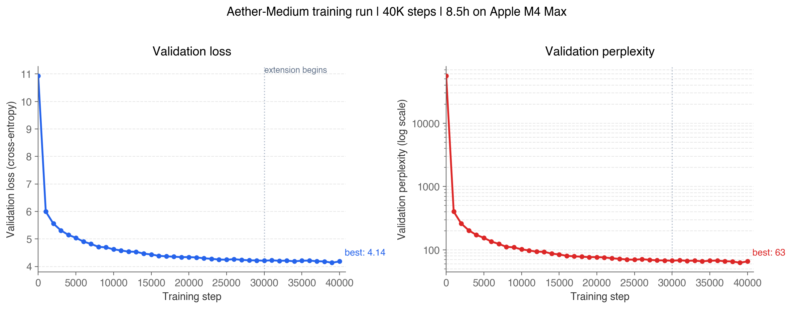

# Aether

A 63.76M-parameter GPT-style language model, trained from scratch on a single laptop for 40,000 steps (30,000 steps followed by a 10,000-step extension) in about 8 hours 34 minutes.

*In Greek mythology, Aether is the primordial god of the bright, upper sky, light, and atmosphere, the pure essence breathed by the gods.*

*This model breathes in tokens and breathes out prose.*

## What this is

Aether is a decoder-only transformer language model, built and trained entirely from scratch. No fine-tuning and no pre-trained weights: the model started from random initialisation and was trained on web text for 40,000 steps: 30,000 steps followed by a 10,000-step extension. Over the full run it saw about 327.7M tokens, sampled at random from a training split of 509.25M tokens (the equivalent of about 0.64 passes over the split).

It is deliberately small and was trained on a single laptop, as an end-to-end exercise covering the LLM pipeline: data ingestion, tokenisation, model architecture, training, inference and evaluation. The model, training loop, data pipeline and sampler were written by hand in PyTorch. The tokeniser is tiktoken's GPT-2 BPE, and the dataset is loaded through Hugging Face `datasets`.

This project follows [Forge](https://github.com/SrihariSr/Forge), a from-scratch ML library I built. Forge reimplements ML concepts, while Aether implements and trains a language model.

## Technical highlights

- **Model**: decoder-only transformer with 63,755,264 parameters, or 63,493,120 excluding position embeddings (12 layers, 8 heads, 512 embedding dim, 512 context length)
- **Training**: 40,000 steps of AdamW (30,000 steps followed by a 10,000-step extension), with warmup + cosine LR decay in each phase, gradient clipping, per-parameter-group weight decay
- **Architecture choices**: weight-tied embeddings, pre-norm residual blocks, GELU feed-forward, no biases in Linear/LayerNorm (LLaMA convention)
- **Data pipeline**: OpenWebText tokenised with GPT-2 BPE (tiktoken), parallelised across 12 CPU cores, memory-mapped binary files for batch sampling
- **Training stability**: GPT-2-style scaled initialisation: every weight whose name ends in `proj.weight` starts with std 0.02/√(2 x n_layer). This covers the residual projections (`attn.out_proj`, `ffn.proj`) and also the attention `qkv_proj`, which is not a residual projection (see Known issues)
- **Inference**: top-k + top-p sampling with repetition penalty over a rolling 64 token window
- **Hardware**: Apple M4 Max with 14-core CPU, 32-core GPU, 36GB unified memory, MPS backend using PyTorch

## Results



**Best validation loss: 4.14** (perplexity 63), at step 39,000. The last evaluation, at step 40,000, measured 4.19 (perplexity 66).

Training took 513.5 minutes (about 8 hours 34 minutes): 381.1 minutes for the first 30,000 steps and 132.4 minutes for the 10,000-step extension.

| Step   | Val loss | Perplexity |
|--------|----------|------------|
| 0      | 10.93    | 55,770     |
| 5,000  | 5.04     | 155        |
| 10,000 | 4.62     | 102        |
| 15,000 | 4.44     | 85         |
| 20,000 | 4.34     | 77         |
| 25,000 | 4.25     | 70         |
| 30,000 | 4.21     | 67         |
| 39,000 | **4.14** | **63**     |
| 40,000 | 4.19     | 66         |

For scale, the smallest model in the [GPT-2 paper](https://cdn.openai.com/better-language-models/language_models_are_unsupervised_multitask_learners.pdf) has 117M parameters, and the WebText dataset used in that paper contains slightly over 8 million documents (40 GB of text). The paper reports no results on OpenWebText, so it gives no direct perplexity comparison for Aether.

### Training throughput

Sustained ~11,150 tokens/sec on an M4 Max throughout the run of about 8 hours 34 minutes. No divergence, no crashes, no thermal emergencies.

## Sample outputs

All outputs below are produced with `temperature=1.0, top_k=40, top_p=0.9, repetition_penalty=1.3`, unedited.

### News prompt

> **Prompt**: *"US senate vote"*
>
> **Output**: US senate vote on Sunday.
>
> "We must work to make sure we don't support the House of Representatives and the Senate Foreign Relations Committee,” he said. “It is essential that we get people interested in protecting us from such a massive issue."
>
> The Washington Post reported on Monday that Trump, under pressure from Congress, and the U.S. Senate, have been able to pass on his own rules of government. The New York Times cited Trump as saying the executive branch has no jurisdiction over whether or not Congress can act or enforce its constitution, including federal immigration law and laws in place for immigrants who are illegally living in countries with more than 10 million foreign nationals.
>
> The Trump administration has repeatedly denied any wrongdoing in the campaign of President Obama’s government — arguing that it is "not a criminal activity" by a country whose political or business interests have been "in the hands of the people," according to an e-mail from The Times, which was sent back

### Corporate PR prompt

> **Prompt**: *"A spokesperson for the company said"*
>
> **Output**: A spokesperson for the company said on Sunday that it was not investigating a report by The Associated Press.
>
> It said an inquiry had been made into possible criminal activity in Russia and said there was no evidence to support such a case.
>
> Koschov, who is currently at the firm’s business partner, did not respond to an email seeking comment on his claims or any other details of the matter. He also declined to return calls from the authorities and told The Associated Press that there were no known reports about Russia involvement in this matter, however.
>
> A spokesman for the Russian state-owned company said it had been working with a group of law enforcement officers.
>
> Russian President Vladimir Putin called the investigation “not going as far back”, saying the agency has “dressed some of that and will continue to review” its reports and is investigating any criminal activity in Russia.
>
> Koschov’s company said it would “underground all our investigations


### Narrative prompt

> **Prompt**: *"Once upon a time"*
>
> **Output**: Once upon a time, I could easily go back to a game where the only way you can do it is find a single level match and I had to try it.
>
> So what are your main goal of the match?
>
> I really love that game. It will be fun if I’m playing around, just like they did on some kind of deck where they were both good at that point. In fact, it is a lot more than a win or two because there is an absolute risk of it being a one-off match. If you think the whole set would come down to a game or not, then you can just go up and do something about it and not win the game.
>
> If I go back to a game where I will always start with that tournament, I want to be able to play at a tournament level but if you do it well, you’ll only get one more shot when you don’t see them in the opening seconds, so be

The model continues the prompt as a first-person discussion of games and tournaments rather than as a fairy tale. OpenWebText has relatively little fairy-tale content, so the model defaulted to the most common first-person genre in its training data.

## Architecture

```
Input tokens (B, T)
    │
    ├─> Token Embedding (50,257 × 512)
    └─> Positional Embedding (512 × 512)
        │
        V
    [Transformer Block] × 12
    │
    │  ┌──────────────────────────────────┐
    │  │ x = x + MultiHeadAttn(LN(x))     │   <- pre-norm residual
    │  │ x = x + FeedForward(LN(x))       │
    │  │                                  │
    │  │  MultiHeadAttn: 8 heads x 64 dim │
    │  │  FeedForward:  512 -> 2048 -> 512│
    │  │                  with GELU       │
    │  └──────────────────────────────────┘
    │
    V
Final LayerNorm
    │
    V
Language-model head (weight-tied to embedding)
    │
    V
Logits (B, T, 50,257)
```

## Training setup

| Hyperparameter         | Value             |
|------------------------|-------------------|
| Optimiser              | AdamW             |
| Betas                  | (0.9, 0.95)       |
| Weight decay           | 0.1 (matrices only) |
| Peak learning rate     | 3e-4 (first 30,000 steps), 5e-5 (extension) |
| Min learning rate      | 3e-5 (first 30,000 steps), 1e-5 (extension) |
| Warmup steps           | 600 (first 30,000 steps), 50 (extension) |
| Total steps            | 40,000 (30,000 plus a 10,000-step extension) |
| LR schedule            | Linear warmup + cosine decay in each phase |
| Gradient clipping      | 1.0 (L2 norm)     |
| Batch size             | 16 sequences      |
| Sequence length        | 512 tokens        |
| Effective tokens/step  | 8,192             |
| Total tokens seen      | 327,671,808 (39,999 optimiser updates x 8,192) |
| Training split         | 509,251,055 tokens (tokens seen equal about 0.64 passes) |

The extension resumed from the step 30,000 checkpoint at step 30,001, so the update for step 30,000 never ran. That gives 30,000 updates in the first phase and 9,999 in the extension.

Validation loss evaluated every 1,000 steps on 50 randomly-sampled batches from a held-out split.

## How to run

```bash
# Set up
python3.12 -m venv venv && source venv/bin/activate
pip install -r requirements.txt

# Check the environment
python setup_check.py

# Prepare data (downloads OpenWebText, tokenises in parallel)
python -m data.download

# Train
python -m training.train

# Generate
python -m evaluate.generate \
    --ckpt checkpoints/medium/best.pt \
    --prompt "<prompt>" \
    --temperature 1.0 --top_k 40 --top_p 0.9 --repetition_penalty 1.3
```

## Known issues

These are kept as they are so that v1's results stay reproducible from this code, within the limits described in items 5 and 6.

1. **Initialisation**: the residual scaling also applies to `qkv_proj`, so Q, K and V start at std 0.02/√24 ≈ 0.0041 rather than 0.02.
2. **Sampler**: `generate()` crops the context to `block_size` (512) and recomputes the full sequence for every token, because there is no KV cache.
3. **Repetition penalty**: it divides every penalised logit, which makes negative logits larger rather than smaller.
4. **Data**: `data/download.py` concatenates documents without an end-of-text token between them.
5. **Batch sampling seed**: `training/train.py` seeds PyTorch but not NumPy, and `get_batch()` draws its offsets from NumPy. A rerun therefore samples different batches and will not match v1's losses exactly.
6. **Extension boundary**: v1 resumed at step 30,001, so it made 39,999 updates. A fresh run of this code also trains step 30,000, which makes 40,000 updates.
7. **Default checkpoint**: `evaluate/generate.py` defaults to `checkpoints/best.pt` rather than `checkpoints/medium/best.pt`, so pass `--ckpt` as shown in "How to run".
8. **Penalty order**: the repetition penalty is applied after top-k and top-p filtering, and it uses the first batch row's history for every row in a batch.

*Out of noise, a voice.*
*Out of weight, a wind.*

Built by [Srihari Srinivasan](https://github.com/SrihariSr), 2026.